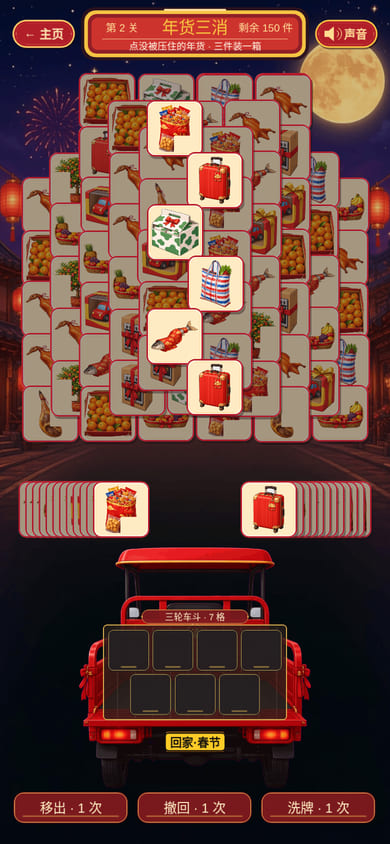
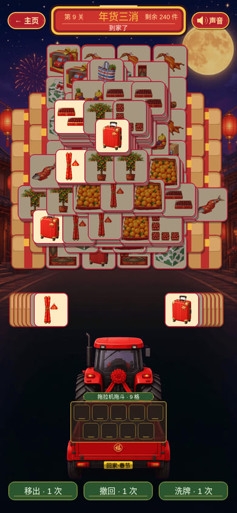

# 塞满回家

春节到了，把年货一层层塞进后备箱，开回家。

《塞满回家》是一款可在手机浏览器里直接玩的网页游戏：主玩法是「羊了个羊」式的年货三消——层层叠叠的年货堆在路上，点没被压住的，飞进车子的货槽，三件同种打包成一箱；槽满了就过不去，但可以复活一次。一路换九种车，从摩托车开到拖拉机，第 9 关「到家了」。另外还有休闲的拖拽装箱、按省份排行，以及每天一关。

[点此试玩](https://feyakit.github.io/smhj-play/)

**禁止任何商业用途；商用授权请通过 [GitHub Issues](https://github.com/feyakit/sai-man-hui-jia/issues) 联系作者。** 源代码采用 [PolyForm Noncommercial License 1.0.0](LICENSE)，美术资源采用 [CC BY-NC 4.0](LICENSE-ASSETS)。版权人：Feyakit。

> **Sai Man Hui Jia** (*Pack Up and Go Home*) is a Spring Festival web game about stuffing New Year goods into a vehicle and heading home. Tap unblocked gifts into the trunk; three of a kind pack into a box. Nine vehicles, nine levels, and level 9 is “home.” Play in the browser: https://feyakit.github.io/smhj-play/  
> Source code is licensed under the PolyForm Noncommercial License 1.0.0; art is CC BY-NC 4.0. **No commercial use.** For a commercial license, contact the author via GitHub Issues. Copyright (c) 2026 Feyakit.

## 试玩

手机浏览器打开：[https://feyakit.github.io/smhj-play/](https://feyakit.github.io/smhj-play/)

需要支持 WebGL 的现代浏览器。音效与背景音乐在首次点击后才会响起（浏览器策略如此）。

<p>
  
  
  
</p>

## 游戏介绍

主题是过年回家：灯笼、明月、春联「千里归途车满福 / 万家团圆岁添春」，横批就是游戏名「塞满回家」。首页那辆红轿车里塞着真实物件画风的年货，车牌在未选择老家时写着「回家·春节」。下面一条弯曲的回家路标着九个站点，进度是「回家进度 n/9」；通关第 9 关后显示「已到家」。

主按钮是「开始装车」（或「继续回家 · 第 n 关」）。下面三枚铜钱分别进入省份排行、每日一关、经典装箱。也可以先「选省份」，再选城市。

## 玩法

### 回家路：年货三消

这是默认的主线。年货层层叠放，只能点没被压住的那一层。点中后，货品飞进画面下方车辆的货槽；同一类凑满三件就会打包消除。槽位满了且凑不成三件即失败，本局可以复活一次（把槽里三件移到旁边的货架上）。关内还有一次「移出」、一次「撤回」、一次「洗牌」。

从第 2 关起，隔一段时间会触发「妈妈又塞了一件」：妈妈往牌堆里再塞进三件同一种、当时比较少见的年货（代码里一次放三张）。插入后会尽量保证这一局仍能过关。

主线一共 9 关，每关换一种车，货槽也跟着变，容量从 7 格逐步到 9 格：

| 关卡 | 车型 | 货槽 |
| --- | --- | --- |
| 第 1 关 | 摩托车 | 摩托后尾箱 |
| 第 2 关 | 电动三轮 | 三轮车斗 |
| 第 3 关 | 红轿车 | 轿车后备箱 |
| 第 4 关 | SUV | SUV 后备箱 |
| 第 5 关 | 面包车 | 面包车后门 |
| 第 6 关 | 皮卡 | 皮卡货斗 |
| 第 7 关 | 小货车 | 货车车厢 |
| 第 8 关 | 大巴车 | 大巴行李舱 |
| 第 9 关 | 拖拉机 | 拖拉机拖斗 |

第 3 关起，关卡标题还会带上路上的地名，依次是：出城收费站、高速服务区、跨江大桥、山区隧道、县城环岛、进村牌楼；第 9 关是「到家了」，通关后进入到家画面，而不是再进下一关。

关内左上角有「← 主页」。如果这局已经动手，返回前会确认：「回主页会放弃本局，确定吗？」

### 经典装箱

休闲模式。把托盘里的年货拖进车厢格子，可旋转、可撤销，要正好填进车型的可用格（有些边角不能放）。这是早期的核心规则，现在作为首页上的「经典装箱」保留。车型包括摩托车、电动三轮、小轿车、SUV、皮卡、五菱宏光、绿皮火车等。

### 省份、城市与车牌

在首页选择省份和城市。车牌会写成「省份简称 + 发牌机关字母 · 春节」，例如洛阳是「豫C·春节」；只选了省份时用省会字母；什么都没选则是「回家·春节」。选中的老家会显示在首页匾额上。

### 省份排行

排行按省份统计，不按城市。标题是「为家乡而战 · 省份排行」。通关记录提交到 Cloudflare Worker，同一设备每一关只计一次。本地可用 `?api=off` 关闭排行请求，或用 `?api=` 指向其他接口地址。

### 每日一关

每天一局（按日期生成，难度会校准到一个比较好过的区间），当天通关后首页会显示「每日一关 · 已塞满」。每日关的车辆按日期在九种车型里轮换。

### 音乐与音效

三消模式的背景音乐和音效都是游戏里实时合成的，不依赖外部音频文件：背景乐是一段 16 小节、104 BPM 的 D 宫五声音阶循环；音效包括点选、飞入、打包、连击、槽位告急、妈妈加塞、通关、失败、到家鞭炮等。首页音量按钮可分别开关音效和音乐。经典装箱还预留了可选的 MP3 音效目录，见 `client/assets/resources/audio/README.md`，目前仓库里没有附带成品音效文件。

## 技术栈

- 游戏客户端：Cocos Creator 3.8.8，Web Mobile，TypeScript
- 核心规则（三消、装箱、关卡生成、排行协议等）是不依赖引擎的纯 TypeScript，可用 Node.js 直接测试
- 测试：vitest；`npm test` 会做类型检查、跑单元测试，并要求 `client/assets/scripts/core/` 行覆盖率至少 90%
- 运行与 CI 使用 Node.js 24
- 省份排行后台：Cloudflare Worker（`smhj-api`）+ D1 数据库（`smhj-rank-apac`）

仓库里的 `client/` 只提交了 `assets/`（脚本、美术、关卡 JSON）。Cocos 的工程文件、场景和编辑器缓存不在版本库中；CI 会用官方 3.8.8 空模板临时拼出一个工程再导出 Web Mobile。

## 目录结构

```
.
├── client/assets/          # 游戏资源与脚本
│   ├── resources/art/      # 年货、车辆、首页与界面美术
│   ├── resources/audio/    # 可选 MP3 音效目录（说明见其中 README）
│   ├── resources/levels/   # 已提交的关卡数据
│   └── scripts/            # TypeScript：核心规则、页面、平台与服务
├── docs/                   # 规格、接手说明、开发记录、截图
├── tests/                  # vitest 测试
├── tools/                  # 关卡生成、美术检查、Cocos 构建与试玩检查
├── worker/                 # 省份排行 Worker 与 D1 表结构
├── LICENSE                 # 源代码许可（PolyForm Noncommercial 1.0.0）
├── LICENSE-ASSETS          # 美术与音频资源许可（CC BY-NC 4.0）
├── package.json
└── README.md
```

更早的里程碑说明仍写在 [docs/handoff.md](docs/handoff.md)、[docs/development-log.md](docs/development-log.md) 和 [docs/spec-v1.2.md](docs/spec-v1.2.md) 里，其中部分内容可能落后于当前玩法，请以本 README 和代码为准。

## 本地开发

需要 [Node.js 24](https://nodejs.org/)。在仓库根目录：

```sh
npm ci
npm test
```

常用脚本：

| 命令 | 作用 |
| --- | --- |
| `npm test` | 类型检查 + 单元测试 + 核心代码行覆盖率门槛 |
| `npm run typecheck` | 只做 TypeScript 检查 |
| `npm run test:watch` | vitest 监视模式 |
| `npm run test:performance` | 五菱车型装箱生成的性能测试（较慢） |
| `npm run art:check` | 检查年货 / 车辆美术资源 |
| `npm run levels:v1` | 重新生成并校验已提交的 V1 关卡 |

关卡生成工具还需要在本机设置环境变量 `LEVEL_SECRET`（不要写入仓库），然后可以：

```sh
npm run levels:generate -- --from 2027-01-15 --days 7
npm run --silent levels:evaluate -- --vehicle wuling --samples 200
npm run levels:upload -- --from 2027-01-15 --days 7 --dry-run
npm run levels:copy-dev
npm run art:templates
```

生成器按日期和关卡编号计算 HMAC 种子。关卡与解分别写入 `levels/` 和 `levels/solutions/`（解目录已被 git 忽略，留给服务端使用）。整个日期范围都成功后才会写文件。`levels:upload` 目前只做本地预检；`levels:copy-dev` 只导出关卡字段到开发目录；轮廓模板输出到 `tools/out/art-templates/`。

## 构建 Web 试玩版

正式的 Web Mobile 导出在 GitHub Actions 工作流「Build Cocos Web Mobile」里完成（Windows 跑手、Cocos Creator 3.8.8）。脚本是 `tools/cocos/build-web-mobile.ps1`：下载编辑器、用空的 2D 模板加上本仓库的 `client/assets`、导出到 `client/build/web-mobile`。构建完成后可用：

```sh
node tools/optimize-web.mjs client/build/web-mobile
```

给产物做图片与脚本压缩，并加上加载页。本地验收可以对该目录起一个静态 HTTP 服务，或运行：

```sh
node --import tsx tools/cocos/smoke-web-mobile.mjs <构建目录> <截图目录>
```

当前对外的试玩站点是 GitHub Pages：[https://feyakit.github.io/smhj-play/](https://feyakit.github.io/smhj-play/)。

## 排行榜后台

后台代码在 `worker/`。`wrangler.toml` 里已经写了 Worker 名称 `smhj-api`（发布到 `*.workers.dev`，不绑定自定义域名）以及 D1 绑定 `DB`、数据库名 `smhj-rank-apac`。表结构见 `worker/schema.sql`：正式榜与隔离测试表分开；测试请求只有在配置了 Worker 密钥 `TEST_KEY` 且请求头匹配时才会写入测试表，不会进入正式榜。

自行部署时，使用 [Wrangler](https://developers.cloudflare.com/workers/wrangler/) 在 `worker/` 目录创建或绑定同名的 D1 数据库、执行 `schema.sql`，再部署该 Worker。把 `TEST_KEY` 配成 Wrangler 密钥，不要把 Cloudflare 账号、API 令牌或测试密钥写进仓库。

游戏默认访问 `https://smhj-api.feyakit.workers.dev`。

## 许可

- 源代码：[PolyForm Noncommercial License 1.0.0](LICENSE)。Required Notice: Copyright (c) 2026 Feyakit。
- 美术与音频资源：[CC BY-NC 4.0](LICENSE-ASSETS)，Copyright (c) 2026 Feyakit。

**禁止任何商业用途。** 这包括但不限于付费发行、广告变现、把本游戏或其美术/代码用于商业产品或服务。个人学习、非商业再分发和修改（须保留许可与署名）是允许的。

**No commercial use is permitted.** For a commercial license, please contact the author via [GitHub Issues](https://github.com/feyakit/sai-man-hui-jia/issues).

商用授权请通过 GitHub Issues 联系作者。
